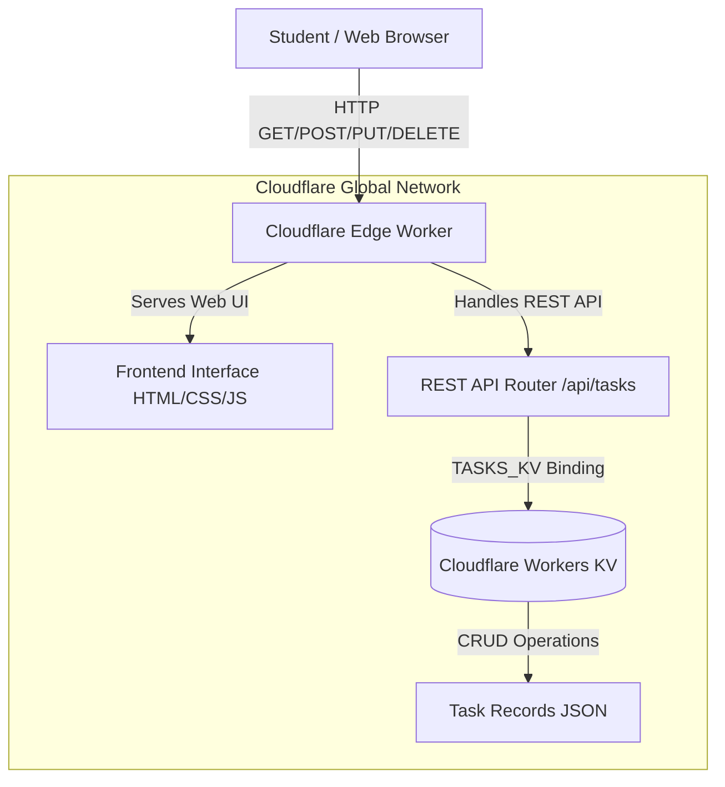
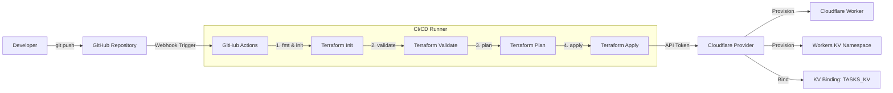

# Automated Deployment of a Serverless Student Task Management Application Using Terraform (IaC)

[](https://github.com/RenukaAlwadkar/devops-task-documentation/actions/workflows/deploy.yml)
[](https://www.terraform.io/)
[](https://workers.cloudflare.com/)
[](https://developers.cloudflare.com/kv/)

A complete **Infrastructure as Code (IaC)** project demonstrating automated provisioning, state management, version control, CI/CD, and lifecycle teardown/recreation of a serverless academic task management platform on **Cloudflare Workers** with **Workers KV** persistence.

---

## 📑 Table of Contents
1. [Project Overview & Problem Statement](#-project-overview--problem-statement)
2. [Proposed System Architecture](#-proposed-system-architecture)
3. [Technologies Used](#-technologies-used)
4. [Repository Structure](#-repository-structure)
5. [Prerequisites](#-prerequisites)
6. [Step-by-Step Implementation Guide](#-step-by-step-implementation-guide)
7. [REST API Documentation](#-rest-api-documentation)
8. [CI/CD Pipeline with GitHub Actions](#-cicd-pipeline-with-github-actions)
9. [Verification & Testing Guide (CRUD & IaC)](#-verification--testing-guide-crud--iac)
10. [Advanced IaC Extensions](#-advanced-iac-extensions)
11. [Evaluation Answers & Viva Q&A](#-evaluation-answers--viva-qa)

---

## 🎯 Project Overview & Problem Statement

Modern cloud applications require multiple infrastructure components (compute, storage, bindings, routing, configuration). Creating these manually through graphical web consoles presents several critical drawbacks:
* **Non-reproducible:** Rebuilding infrastructure in failure scenarios requires manual effort.
* **Prone to Human Error:** Inconsistent configuration parameters and missed steps.
* **No Version Control:** Changes are untracked and cannot easily be audited or rolled back.
* **Environment Drift:** Discrepancies quickly emerge between `dev`, `test`, and `production`.

**Infrastructure as Code (IaC)** resolves this by declaring all resources in version-controlled configuration files. In this project, the **Cloudflare Worker** compute service and **Cloudflare Workers KV** key-value storage are provisioned and orchestrated 100% via **Terraform**.

---

## 🏛️ Proposed System Architecture

### Runtime & Application Architecture


### Infrastructure as Code & CI/CD Pipeline


---

## 🧰 Technologies Used

| Layer | Technology | Purpose |
|---|---|---|
| **IaC Orchestrator** | **Terraform** (`~> 1.5.0+`) | Declarative infrastructure definition, planning, and state management. |
| **Provider** | **`cloudflare/cloudflare`** (`~> 4.35`) | Terraform provider communicating with Cloudflare REST APIs. |
| **Serverless Compute** | **Cloudflare Workers** | V8 engine edge execution serving API endpoints and static assets. |
| **Distributed Storage** | **Cloudflare Workers KV** | High-throughput, low-latency global key-value store for task persistence. |
| **Frontend UI** | **HTML5, Modern CSS3, JavaScript** | Responsive dark-mode interface with stats cards, filtering, and modals. |
| **Version Control** | **Git & GitHub** | Atomic version history and remote collaboration. |
| **CI/CD Automation** | **GitHub Actions** | Automated validation, linting, planning, and deployment pipeline. |

---

## 📂 Repository Structure

```
student-task-manager-iac/
├── terraform/
│   ├── providers.tf             # Cloudflare provider & Terraform version constraints
│   ├── main.tf                  # Resources: KV Namespace, Worker script & KV binding
│   ├── variables.tf             # Variable declarations with validation
│   ├── outputs.tf               # Terraform outputs (Worker Name, KV ID, App URL)
│   └── terraform.tfvars.example # Template for user credentials
│
├── application/
│   ├── worker.js                # Cloudflare Worker code (REST API + UI delivery)
│   ├── index.html               # Responsive student task management dashboard
│   ├── style.css                # Glassmorphic dark styling & animations
│   └── script.js                # Client controller for CRUD operations & filtering
│
├── modules/                     # Advanced IaC Reusable Components (Section 35)
│   ├── kv/                      # Reusable KV namespace module
│   │   ├── main.tf
│   │   ├── variables.tf
│   │   └── outputs.tf
│   └── worker/                  # Reusable Worker script module
│       ├── main.tf
│       ├── variables.tf
│       └── outputs.tf
│
├── environments/                # Multi-Environment Configurations (Section 34)
│   ├── dev.tfvars
│   ├── test.tfvars
│   └── production.tfvars
│
├── .github/
│   └── workflows/
│       └── deploy.yml           # Automated GitHub Actions CI/CD deployment workflow
│
├── screenshots/                 # Evaluation screenshots checklist & evidence
│   ├── 08_working_web_app.png
│   ├── 09_create_operation.png
│   ├── 10_update_operation.png
│   ├── 11_delete_operation.png
│   └── README.md
│
├── .gitignore                   # Excludes tfstate, .env, and API credentials
├── PROJECT_REPORT.md            # Complete 10-Chapter mini project report & Viva answers
└── README.md                    # Project documentation (this file)
```

---

## ⚡ Prerequisites

1. **Terraform CLI**: Installed (`terraform -version` >= 1.5.0).
2. **Git**: Installed (`git --version` >= 2.0.0).
3. **Cloudflare Account**: Free tier account at [cloudflare.com](https://dash.cloudflare.com).
4. **Cloudflare API Token**: Created with:
   * `Account` | `Workers Scripts` | `Edit`
   * `Account` | `Workers KV Storage` | `Edit`
5. **Cloudflare Account ID**: Found in Cloudflare Dashboard under *Workers & Pages* (right sidebar).

---

## 🚀 Step-by-Step Implementation Guide

### Step 1: Configure Credentials
Navigate into the `terraform/` directory and create your variable configuration:
```bash
cd terraform
cp terraform.tfvars.example terraform.tfvars
```
Edit `terraform.tfvars` with your actual credentials:
```hcl
cloudflare_account_id = "your_32_character_account_id"
cloudflare_api_token  = "your_cloudflare_api_token"
worker_name           = "student-task-manager"
kv_namespace_name     = "student_tasks"
environment           = "production"
```
> [!IMPORTANT]
> Never commit `terraform.tfvars` to GitHub! It is already ignored in `.gitignore`.

### Step 2: Initialize Terraform (Step 12)
```bash
terraform init
```
*Expected Output:* `Terraform has been successfully initialized!`

### Step 3: Format and Validate Configuration (Steps 13 & 14)
```bash
terraform fmt
terraform validate
```
*Expected Output:* `Success! The configuration is valid.`

### Step 4: Generate Execution Plan (Step 15)
```bash
terraform plan
```
*Observation:* Terraform inspects the configuration and identifies:
* `+ cloudflare_workers_kv_namespace.student_tasks` (create)
* `+ cloudflare_workers_script.student_task_manager` (create with `TASKS_KV` binding)
* `Plan: 2 to add, 0 to change, 0 to destroy.`

### Step 5: Provision Cloud Infrastructure (Step 16)
```bash
terraform apply
```
Type `yes` when prompted.
*Expected Output:*
```
Apply complete! Resources: 2 added, 0 changed, 0 destroyed.

Outputs:
application_url    = "https://student-task-manager.workers.dev"
kv_namespace_id    = "xxxxxxxxxxxxxxxxxxxxxxxxxxxxxxxx"
kv_namespace_title = "student_tasks"
worker_name        = "student-task-manager"
```

### Step 6: Verify in Cloudflare Dashboard (Step 17)
1. Open Cloudflare Dashboard -> **Workers & Pages**.
2. Verify `student-task-manager` is listed.
3. Open **Workers & Pages** -> **KV** -> Confirm `student_tasks` namespace is created.
4. Check **Settings** -> **Variables and KV Namespace Bindings** -> Confirm `TASKS_KV` binding is linked.

### Step 7: Demonstrate Infrastructure Modification (Step 21)
Modify an attribute in `terraform/variables.tf` or `terraform.tfvars`:
```hcl
environment = "dev"
```
Run:
```bash
terraform plan
```
Terraform detects the change (`~ update in-place` or `+ create / - destroy`). Apply it with `terraform apply`.

### Step 8: Demonstrate Infrastructure Teardown & Recreation (Steps 27-29)
Demonstrate the core IaC advantage:
```bash
# 1. Inspect destroy plan
terraform plan -destroy

# 2. Destroy infrastructure
terraform destroy -auto-approve

# 3. Verify in Cloudflare dashboard that resources are deleted.

# 4. Recreate the entire infrastructure automatically
terraform apply -auto-approve
```

---

## 📡 REST API Documentation

The serverless Worker exposes the following RESTful endpoints:

| Method | Endpoint | Description | Request Body Example | Response Code |
|---|---|---|---|---|
| `GET` | `/api/tasks` | Retrieve all academic tasks from KV. | None | `200 OK` |
| `GET` | `/api/tasks/{id}` | Retrieve single task by its unique ID. | None | `200 OK` / `404 Not Found` |
| `POST` | `/api/tasks` | Create a new academic task. | `{"title":"Complete Cloud Assignment","priority":"High","status":"Pending"}` | `201 Created` |
| `PUT` | `/api/tasks/{id}` | Update title, status, or priority. | `{"status":"Completed"}` | `200 OK` |
| `DELETE` | `/api/tasks/{id}` | Delete task from Workers KV. | None | `200 OK` |
| `GET` | `/health` | Health check & KV binding status. | None | `200 OK` |

### Sample `curl` Commands
```bash
# List all tasks
curl https://student-task-manager.workers.dev/api/tasks

# Create a new task
curl -X POST https://student-task-manager.workers.dev/api/tasks \
  -H "Content-Type: application/json" \
  -d '{"title":"Prepare Project Presentation","priority":"High","status":"Pending"}'

# Update status to Completed
curl -X PUT https://student-task-manager.workers.dev/api/tasks/T101 \
  -H "Content-Type: application/json" \
  -d '{"status":"Completed"}'

# Delete task
curl -X DELETE https://student-task-manager.workers.dev/api/tasks/T101
```

---

## 🔄 CI/CD Pipeline with GitHub Actions

The repository includes an enterprise-grade automated CI/CD pipeline at [`.github/workflows/deploy.yml`](file:///.github/workflows/deploy.yml).

### Workflow Stages:
1. **Linting (`terraform fmt -check`)**: Enforces standard Terraform syntax formatting.
2. **Initialization (`terraform init`)**: Downloads official Cloudflare provider plugin.
3. **Static Validation (`terraform validate`)**: Validates block structure and attribute types.
4. **Speculative Execution (`terraform plan`)**: Generates an execution plan artifact.
5. **Deployment (`terraform apply`)**: Automatically provisions/updates Cloudflare infrastructure upon merging code into `main`.

### Setting Up Secrets in GitHub:
1. Navigate to your repository on GitHub.
2. Go to **Settings** -> **Secrets and variables** -> **Actions**.
3. Add two repository secrets:
   * `CLOUDFLARE_API_TOKEN`: Your Cloudflare API Token.
   * `CLOUDFLARE_ACCOUNT_ID`: Your Cloudflare Account ID.

---

## 🧪 Verification & Testing Guide (CRUD & IaC)

| Test Case | Objective | Action | Expected Result | Verified |
|---|---|---|---|---|
| **TC1** | Create Task | Fill task form with title *"Complete Cloud Assignment"*, Priority *"High"*, Status *"Pending"*. | Task saved in KV; row added to UI; total count increments. | ✅ |
| **TC2** | Read Tasks | Load application page. | Tasks stored in Cloudflare KV rendered in table. | ✅ |
| **TC3** | Update Task | Click *"Status"* button to toggle from *"Pending"* to *"Completed"*. | Badge changes to emerald *"Completed"*; completed count increments. | ✅ |
| **TC4** | Delete Task | Click trash icon and confirm in modal dialog. | Task removed from table and deleted from Workers KV. | ✅ |
| **TC5** | IaC Lifecycle | Run `terraform destroy` followed by `terraform apply`. | Full infrastructure automatically dismantled and recreated identically. | ✅ |

---

## 💡 Advanced IaC Extensions

### 1. Reusable Terraform Modules (`modules/`)
* [`modules/kv/`](file:///modules/kv): Encapsulates Cloudflare Workers KV provisioning logic.
* [`modules/worker/`](file:///modules/worker): Encapsulates Worker script deployment, runtime flags, and KV bindings.

### 2. Multi-Environment Workspaces (`environments/`)
* `dev.tfvars`: Deploys isolated `student-task-manager-dev` worker with `student_tasks_dev` KV namespace.
* `test.tfvars`: Staging verification environment.
* `production.tfvars`: Production live environment.

Execute multi-environment plans with:
```bash
terraform plan -var-file="../environments/dev.tfvars"
terraform plan -var-file="../environments/production.tfvars"
```

---

## 📚 Complete Project Report & Viva Answers

The full **10-Chapter Project Report**, along with complete answers to **all 20 evaluation questions** and **Viva voce preparation**, is available in [PROJECT_REPORT.md](file:///PROJECT_REPORT.md).
